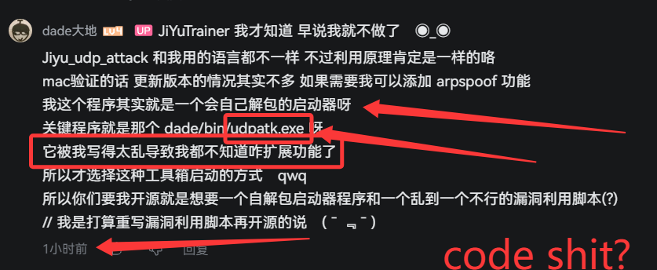

# OpenDademain



`dademain.exe`（"极域工具箱"）的开源重实现：读通反编译结果后，用 C++17 重写的版本。

原程序是闭源的 7.8 MB 单文件，业务逻辑约 8,670 行（其余是 MSVC CRT/STL），核心是
"自解包 + 配置驱动 + 提权 + 菜单执行"。本仓库把这部分完整实现了一遍，并把"载荷"做成
**可配置的通用机制**（`res/payload/` 下放什么就打包什么），而不是硬编码。

> [!WARNING]
> **请先读这一节再决定要不要运行。**
> 本项目的默认配置里包含"远程命令 / 一键布控 / 关机·重启·蓝屏打击"这类**针对他人计算机**的菜单项，
> 程序运行时还会尝试**复制 SYSTEM 令牌**来获取 UIAccess 权限。
> 仓库本身只分发最小的示例载荷，但在你本地构建时，工作区里的所有 `res/payload/` 文件都会被嵌进 exe。
> 这类功能在未授权机器上使用可能触犯《刑法》第 285/286 条、《网络安全法》以及校规/公司制度。
> 详见 [11. 安全与法律声明](#11-安全与法律声明)。

## 目录

- [1. 这是什么](#1-这是什么)
- [2. 项目结构](#2-项目结构)
- [3. 构建](#3-构建)
- [4. 运行](#4-运行)
- [5. 菜单命令](#5-菜单命令)
- [6. 载荷机制](#6-载荷机制)
- [7. 配置格式](#7-配置格式)
- [8. 与原始二进制的差异](#8-与原始二进制的差异)
- [9. 验收（可复现）](#9-验收可复现)
- [10. 已知限制](#10-已知限制)
- [11. 安全与法律声明](#11-安全与法律声明)
- [12. 许可证](#12-许可证)

---

## 1. 这是什么

**代码量**：7 个 `.cpp` 共 1,207 行 + 7 个头文件共 183 行，合计 1,390 行 C++17；另有约 200 行
CMake / 批处理构建脚本。没有第三方依赖，只链 `shell32` / `advapi32` / `user32`。

**特点**

- **可编译**：MSVC 2022 + CMake + Ninja，一条 `build.bat`。当前仓库实测 0 条 warning
  （MSVC 19.51.36260），产物 `build\bin\dademain.exe` 141,824 字节
- **可审计**：1,390 行，模块职责单一，所有"与原版不同"的地方都在源码注释里写了原因
- **行为对齐**：`.dade` 的 `工具:A>B>C` 菜单树、`prompts` 交互、`runas` / `newconsole` /
  `hidden` / `wait` 语义，以及首次运行门禁、自解包、`!r` 还原，都按原版行为实现
- **载荷可配置**：`res/payload/` 下放什么就打包什么，不需要改代码
- **不夹带第三方二进制**：`udpatk.exe` / `miniweb.exe` 不在仓库里，也不随仓库分发

> 关于数字：代码行数用 PowerShell 逐文件统计；exe 大小是 `build.bat` 跑完后的实测值。
> 旧版 README 里的"约 1,700 行 / 约 124 KB"与当前仓库不符，这里已按实测更正。
> exe 会随 `res/payload/` 的内容变大——本机工作区里有 14 个载荷，所以比公开发行版大。

## 2. 项目结构

```
OpenDademain/
├─ CMakeLists.txt        目标定义 + 资源生成规则
├─ build.bat             一步构建（定位 vcvars64 → cmake → ninja）
├─ cmake/gen_res.cmake   扫描 res/payload/，生成 .rc 与 TOOLS_MANIFEST
├─ src/
│  ├─ common.h           ToolNode / PromptSpec、资源名与常量
│  ├─ console.*          控制台读写：WriteConsoleW，重定向时按行读字节
│  ├─ util.*             路径拼接 / 整文件读写 / UTF-8 转换 / 建目录
│  ├─ config.*           .dade 解析：建树、键别名、prompts、递归剪枝
│  ├─ payload.*          按 TOOLS_MANIFEST 自解包；释放并打开 readme.html
│  ├─ elevate.*          IsElevated / 复制 SYSTEM 令牌 / UIAccess 重启 / 热键线程
│  ├─ runner.*           RunTools：子菜单、参数交互、拼命令行、runas、等待
│  └─ main.cpp           首次运行门禁 + 主流程 + 菜单循环
├─ res/
│  ├─ default.dade       CFG_DADE：打包进 exe 的默认配置（含原版菜单，见 §10）
│  ├─ default.dade.example  干净的教学配置，改配置时建议从这里抄
│  ├─ readme.html        README_HTML：菜单里 h 打开的内置帮助
│  └─ payload/           构建期全部嵌入的载荷目录
├─ test/smoke.ps1        可复现的冒烟测试（见 §9）
├─ docs/                 文档配图
└─ LICENSE               GPL-3.0
```

三个文件容易被混淆，先说明白：

| 文件 | 是什么 |
|---|---|
| `README.md` | 就是你正在读的这份，给仓库维护者和编译者看 |
| `res/readme.html` | 程序内置的帮助文档，菜单 `h` / 首次运行打开的是它 |
| `res/default.dade` | 首次运行释放到 `dade\.dade` 的默认配置 |

## 3. 构建

要求：Windows 10/11（x64）+ Visual Studio 2022（C++ 生成工具）+ CMake ≥ 3.20 + Ninja。

```bat
build.bat
```

脚本会依次尝试 `Program Files` 下的常见安装位置，再用 `vswhere.exe` 兜底定位
`vcvars64.bat`，然后执行：

```
cmake -S . -B build -G Ninja -DCMAKE_BUILD_TYPE=Release
cmake --build build
```

产物：`build\bin\dademain.exe`（本机 141,824 字节，只链 `shell32/advapi32/user32`）。
exe 的大小由 `res/payload/` 里的文件决定。

也可以手动构建（任意生成器）：

```bat
cmake -S . -B build -G "Visual Studio 17 2022" -A x64
cmake --build build --config Release
```

> **构建注意**：改过 `src/common.h` 里的 `ToolNode` 结构后请做一次干净构建（删掉 `build\` 重跑）。
> 增量构建若残留旧目标文件，会出现"存了某些字段就崩"的 ABI 不一致问题。

## 4. 运行

首次运行会在 exe 同级创建：

```
dademain.exe
eula.txt                  首次运行生成，内容里 eula=true 才放行
readme.html               首次运行写出并打开（在 exe 目录，不在 dade\ 里）
dade\
├─ .dade                  工具清单（从内置资源释放，可手工修改）
├─ .version               "1.0.0.0"（7 字节 ASCII），用于判断是否需要重新解压
├─ hello.bat
└─ tools\whoami.bat       子目录层级会被自动创建
```

**工具路径与工作目录都相对 `dade\`**（与原程序一致），不是 exe 目录。

调试时加 `--safe` 跳过 UAC 与 UIAccess：

```bat
dademain.exe --safe
```

不加 `--safe` 时，程序的行为是：配置里有 `RunAsAdmin=1` 的工具且当前未提权 → 用
`ShellExecuteExW("runas")` 重启自己；随后（在已提权的情况下）尝试从 `winlogon.exe` /
`services.exe` 复制 SYSTEM 令牌，给自身令牌打开 `TokenUIAccess`，再用
`CreateProcessAsUserW` 启动新实例接管。拿不到 UIAccess 时降级为"窗口置顶 + 热键"。

## 5. 菜单命令

| 输入 | 作用 |
|---|---|
| `序号` | 执行对应工具 / 进入子菜单 |
| `0` | 子菜单里返回上级 |
| `r` / `reload` | 重新读取配置 |
| `!r` / `restore` | 备份 `.dade` 为 `.dade.bak`，还原内置默认配置并重新解压 |
| `h` / `help` / `?` | 打开内置的 `readme.html` |
| `q` / `Q` / `exit` | 退出 |

输入被重定向（管道 / 文件）时，程序按字节读、按行切、UTF-8 解码，所以可以用
`echo q | dademain.exe --safe` 这种形式做脚本化测试。

## 6. 载荷机制

原版的做法是"资源 + 清单"：把文件塞进 `.rsrc`，首次运行按清单释放。本工程沿用同一机制，
但改成**构建期自动生成**：

1. 把文件丢进 `res/payload/`（可以带子目录，扩展名随意）：

   ```
   res/payload/
   ├─ hello.bat
   └─ tools\whoami.bat
   ```

2. 重新构建。`cmake/gen_res.cmake` 会为每个文件生成一条 `PAYLOAD_n RCDATA`，并写出
   `build\tools_manifest.txt`：

   ```
   CFG_DADE|.dade
   PAYLOAD_1|hello.bat
   PAYLOAD_2|tools/whoami.bat
   ```

3. 首次运行（或删掉 `dade\.version` 后运行）就会释放到 `dade\` 下的对应路径。

释放规则（见 `src/payload.cpp`）：

- 清单里的 `/` 会被换成 `\`，缺失的目录自动创建；
- **以 `.dade` 结尾的目标若已存在则跳过**（保护用户改过的配置），其它文件一律覆盖；
- 全部释放成功后才写 `.version`；中途失败下次会重来；
- 想强制重发：主菜单输入 `!r`，或删掉 `dade\.version`；
- 资源名在 `build\payload_stage\` 里被复制成 ASCII 名字再交给 `rc.exe`——`rc.exe` 按 ANSI
  代码页解析 `.rc`，遇到中文名/空格会直接报 RC2135。

> **仓库里实际打包了什么**：载荷目录里，git 只跟踪 `hello.bat` 和 `tools\whoami.bat` 两个示例文件。
> 原版的攻击性批处理、`server/` `shell/` 占位目录以及第三方 `udpatk.exe` / `miniweb.exe`
> 都被 `.gitignore` 排除，不随仓库分发（但它们如果存在于你的本地工作区，构建时仍会被打进 exe）。

在 `.dade` 里引用载荷时，`Path` 相对 `dade\`：

```ini
[工具:演示>查看本机信息]
Name=查看本机信息
Path=tools\whoami.bat
NewConsole=1
Wait=1
```

## 7. 配置格式

UTF-8（可带 BOM）的 INI 风格文本；`#` 或 `;` 开头为注释；`[段名]` 开段；
第一个 `[段]` 之前的键会被忽略。

### 段名 = 菜单路径

段名是 **`工具:` + 路径**，路径用 `>` 分层，这就是菜单树的来源：

```ini
[工具:极域小工具]                 ; 顶层分组
Name=极域小工具

[工具:极域小工具>脱控功能]         ; 上一层是 极域小工具
Name=脱控功能

[工具:极域小工具>脱控功能>关闭极域]  ; 再下一层
Name=关闭极域
Path=break.bat
RunAsAdmin=1
Wait=1
```

- 子节点的父路径 = 去掉最后一个 `>` 段；找不到父节点会打印
  `[-] 子项 [X] 找不到父路径 [Y]`，并把该项降到顶层。
- 段名不带 `工具:` 前缀时，也是按顶层节点处理（只是不参与 `>` 分层）。
- 既没有 `Path` 又没有子节点的段会被丢弃：`[-] [X] 无可用 Path 且无子项, 已忽略`；
  子层同样会剪枝，不只是顶层。
- `Name` 不写时默认取路径最后一段。

### 键（大小写不敏感）

| 键 | 别名 | 含义 |
|---|---|---|
| `Name` | | 显示名 |
| `Path` | `Exe` `File` | 可执行文件，相对 `dade\`；不存在时按原样交给系统解析（支持 `cmd.exe` 这种裸名字） |
| `Args` | `Arguments` `Params` | 命令行参数，支持 `{prompt键}` |
| `WorkDir` | `WorkingDir` `Dir` | 工作目录，相对 `dade\`；不存在时退回 `dade\` |
| `Description` | `Desc` `Comment` | 描述，菜单里显示为 `名字 - 描述` |
| `RunAsAdmin` | `Admin` | 需要管理员：未提权时走 `ShellExecuteExW("runas")` |
| `NewConsole` | | 子进程使用 `CREATE_NEW_CONSOLE` |
| `HideWindow` | `Hidden` | `STARTF_USESHOWWINDOW` + `SW_HIDE`（需同时 `NewConsole=1`，否则打印警告并忽略） |
| `Wait` | | `1` 等待子进程结束；`0` 不等；不写则"开新控制台时才等" |
| `Prompts` | `Prompt` | 交互参数，见下 |

布尔键接受 `true` / `1` / `yes` / `on`（大小写不敏感），其它值一律视为 false；
`Wait` 只区分"真值"和"非真值"，写 `2` 等同于 `0`。

### Prompts

格式 `键:提示[:默认值]`，多条用 `;` 分隔；默认值里可以再含 `:`（只有前两段被切分）：

```ini
Prompts=ip:指定ip地址 [默认全员]
Args=-c "cmd /c shutdown -s -t 0" -ip {ip}

Prompts=port:web 端口:80;dir:共享目录:.\
Args=... --port {port} --dir {dir}
```

- `{键}` 会被用户输入替换（同一占位符出现多次会全部替换）；直接回车用默认值；
  输入 `back` / `exit` 放弃本次执行。
- 默认值为空时，提示语原样显示；默认值非空时会追加 ` [默认值]`。

完整的示例配置见 [`res/default.dade.example`](res/default.dade.example)。

## 8. 与原始二进制的差异

均为有意为之，源码注释里都标了原因：

1. **`--safe` 开关**：一键跳过 UAC / UIAccess，方便本地调试。
2. **UIAccess 重启后父进程退出**：原实现 `CreateProcessAsUserW` 成功后会留下两个实例。
3. **控制台 I/O 用 `ReadConsoleW` / `WriteConsoleW`**：避免 `std::wcin` 在重定向输入、
   中文输入下的编码问题；输入被重定向时按字节读、按行切、UTF-8 解码。
4. **`eula.txt` 按行解析**：原实现是"全文找第一个 `eula` 再找下一个 `=`"，
   说明文字里出现 `eula` 就会误判。
5. **`hidden` 校验与递归剪枝**：原实现的"无 Path 且无子项则丢弃"只处理了顶层，
   这里连子层一起剪。
6. **`!r` 真正能还原配置**：原实现只是清空 `.version`，但解压器会跳过已存在的 `.dade`，
   所以它其实还原不了配置；这里先备份成 `.dade.bak` 再删除。
7. **`Path` 不存在时才走系统解析**：`lpApplicationName` 非空时 Windows 不搜 `PATH`，
   原实现因此无法启动 `cmd.exe` 这类裸名字。
8. **文本编码**：`.version` 写成 ASCII（7 字节，与原文一致），`eula.txt` 写成 UTF-8。

## 9. 验收（可复现）

仓库里**没有**自动化测试框架，只有一份冒烟脚本（先跑一次 `build.bat`，脚本默认用
`build\bin\dademain.exe`，也可用 `-Exe` 指定）：

```powershell
powershell -NoProfile -ExecutionPolicy Bypass -File test\smoke.ps1
```

它把 exe 复制到 `build\.smoke-<guid>\`，预置 `.dade` 与 `.version` 跳过首次运行门禁，
然后喂入 `xyz` → `1` → `0` → `!r` → `r` → `q`，检查 13 项：退出码、菜单渲染、无效输入、
子菜单标题、`!r` 还原、`r` 重载、释放计数、`.version` 长度为 7、`.dade.bak` 备份、
示例载荷释放、`bye.` 收尾。通过时退出码为 0。

> 刚复制出来的 exe 第一次启动可能被本机安全软件拦下（退出码 -1、无输出），脚本会自动重试，
> 最多 3 次。这是本机环境行为，不是程序缺陷。

冒烟脚本覆盖不到、需要手工验证的部分：

| 项目 | 怎么验 | 预期 |
|---|---|---|
| 首次运行门禁 | 删掉 `dade\.version` 与 `eula.txt` 后运行 | 写 `eula.txt`、打开 `readme.html`、`pause` 后按 `eula=true` 放行 |
| `eula=false` 拦截 | 把 `eula.txt` 改成 `eula=false` | 打印提示并退出 |
| Prompts 交互 | 选一个带 `Prompts` 的条目，分别输入值和直接回车 | 值替换到 `{键}`；回车取默认值 |
| 放弃执行 | 在 Prompts 里输入 `back` / `exit` | 不启动子进程，回到主菜单 |
| `RunAsAdmin` | 非管理员下选一个 `RunAsAdmin=1` 的条目 | 弹 UAC 提权 |
| `Wait` 语义 | 对同一脚本分别设 `Wait=1` / `Wait=0` | 前者等子进程结束，后者立刻回菜单 |
| `--safe` | 以 `--safe` 运行 | 不弹 UAC、不尝试 UIAccess |

## 10. 已知限制

- **开箱状态下多数菜单项跑不起来**：`res/default.dade` 引用的 `bin\udpatk.exe`、
  `bin\miniweb.exe` 以及若干批处理**不随仓库分发**，选中后会提示启动失败。
  仓库只保证启动器本身可用。
- **只实现消费端**：没有"新增/编辑工具"的 UI，改配置需手工编辑 `.dade`。
- **没有签名校验**（与原程序一致），`.dade` 和载荷都是明文。
- **没有自动化测试**：`test\smoke.ps1` 只覆盖主流程；Prompts、UAC、UIAccess、首次运行门禁
  仍需按 §9 的表格手工验证。
- **UIAccess 不稳定**：依赖管理员权限与 `SeTcbPrivilege`，拿不到时降级为"窗口置顶 + 热键"。
- **平台**：只在 Windows 11 x64 + MSVC 19.51 上验证过；Win10 未实测。
- 未实现原版"帮助文档内嵌浏览器"之外的一些显示细节。

## 11. 安全与法律声明

**这个程序会做什么**（按代码实现，不含推测）：

- 首次运行写 `eula.txt`，用 `ShellExecute` 打开 `readme.html`；
- 按 `TOOLS_MANIFEST` 把内置载荷释放到 `dade\`；
- 配置里有 `RunAsAdmin=1` 的条目且当前未提权时，用 `runas` 重启自己；
- 提权后尝试从 `winlogon.exe` / `services.exe` 复制 SYSTEM 令牌，为自身令牌打开
  `TokenUIAccess`，再以新令牌启动新实例（`--safe` 可全部跳过）；
- 按 `.dade` 的配置启动外部程序，包括以管理员身份、隐藏窗口、新控制台启动；
- 拿不到 UIAccess 时注册 `Ctrl+Shift+D` 热键，用于显示/隐藏自己的控制台窗口。

**默认配置与本地载荷里有什么**：`res/default.dade` 的菜单包含"关机 / 重启 / 蓝屏打击"、
"发送命令"、"一键布控"等条目；本地工作区（不随仓库分发）的载荷里还有用于投放远控的批处理、
以及一个把 `C:\Windows\System32\osk.exe` 替换成 `cmd.exe` 的部署脚本。
这些条目的实现依赖不随仓库分发的 `udpatk.exe` / `miniweb.exe` 与批处理文件，**在干净检出下不可用**。

**法律提示**：未经授权对他人计算机实施远程命令执行、植入程序、干扰系统运行，
可能构成《中华人民共和国刑法》第 285 条（非法侵入/控制计算机信息系统）、第 286 条
（破坏计算机信息系统），以及违反《网络安全法》。在学校、公司等场景还会违反校规与管理制度。
**GPL 是著作权许可，不是"运行授权"**：它允许你复制、修改、分发这份代码，但不改变
"你有没有权在某台机器上运行它、或用它去操作别的机器"这个事实——后者取决于你本人是否获得了授权。

**如果你只是想读代码**：不需要运行。想跑的话，建议用隔离的虚拟机、加 `--safe`，
并在构建前清空 `res/payload/` 里你不打算使用的载荷。

## 12. 许可证

本项目以 **GNU General Public License v3.0（GPL-3.0）** 发布，全文见 [LICENSE](LICENSE)。

- 你可以复制、修改、再分发，但再分发衍生作品时必须同样以 GPL-3.0 授权并附带对应源码；
- 分发时请保留版权声明与免责条款（GPL-3.0 §15、§16）；
- `res/payload/` 里若有第三方提供的二进制或脚本，其版权归各自作者，不适用本项目的 GPL 许可
  （这些文件也不随仓库分发）；如果你要分发它们，请自行确认你有权这么做。

建议在每个源文件头部加一行：

```cpp
// SPDX-License-Identifier: GPL-3.0-or-later
```
